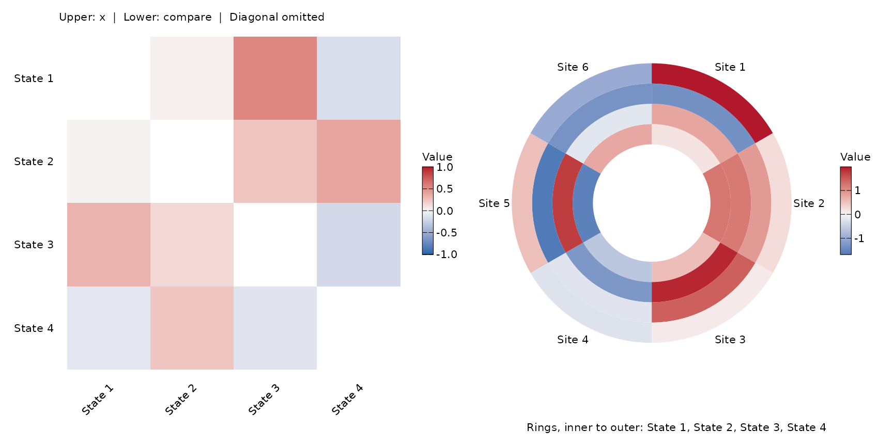
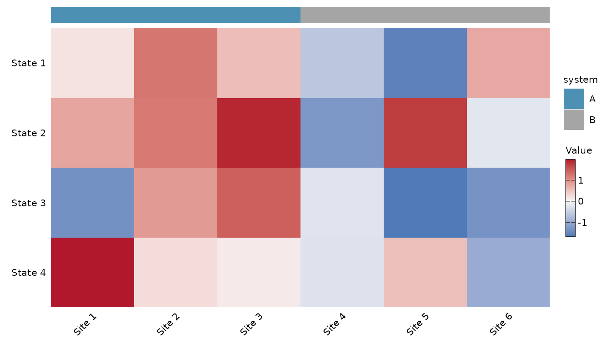
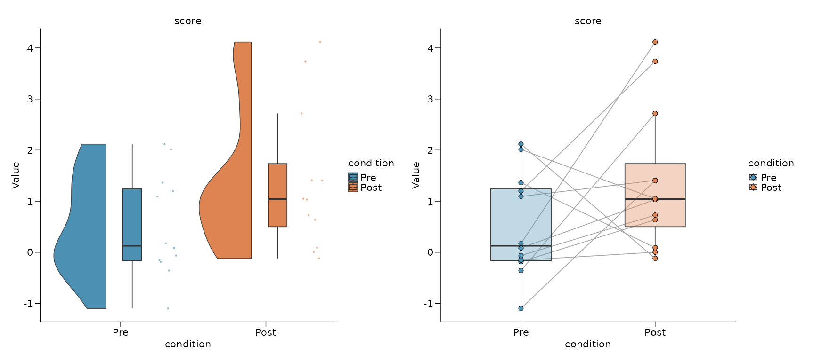
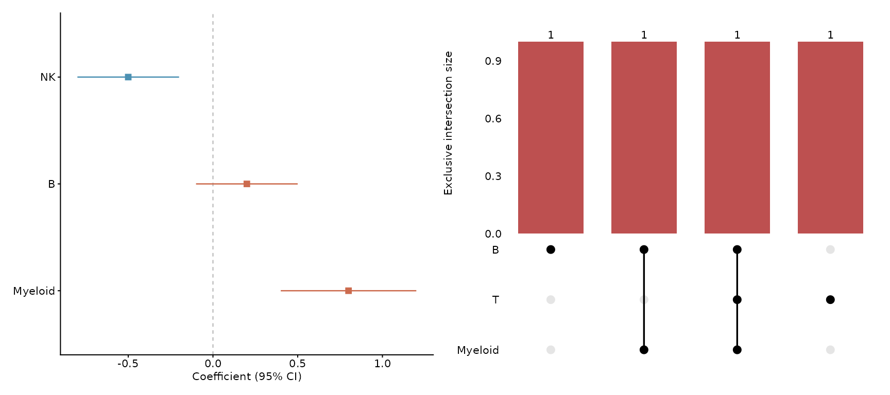
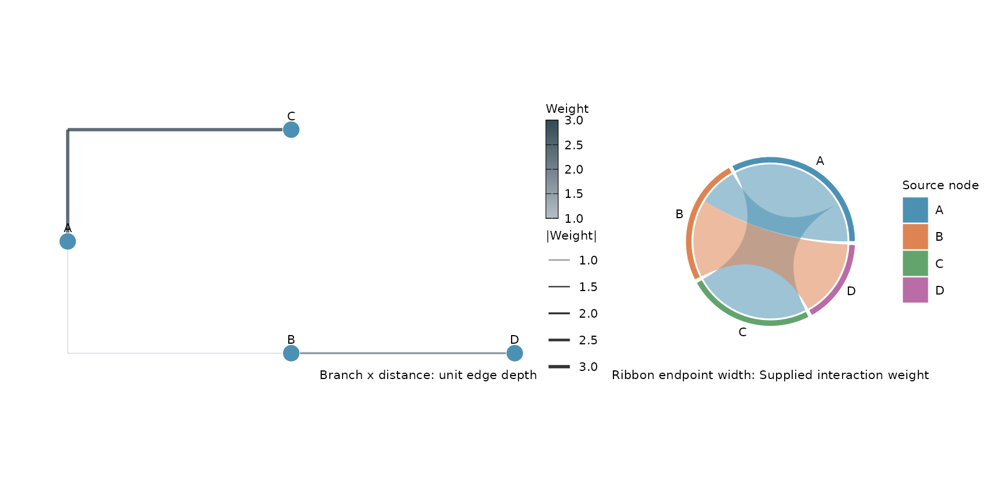
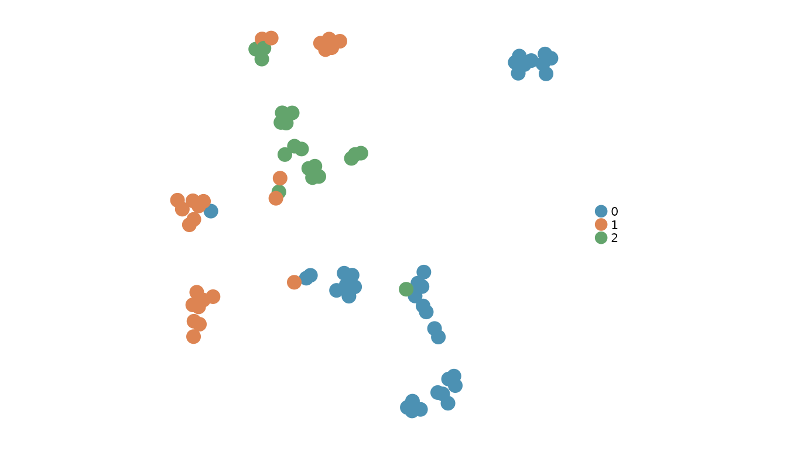
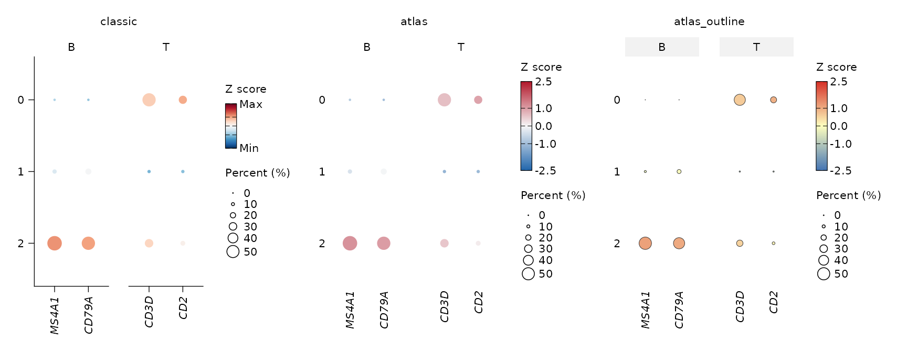
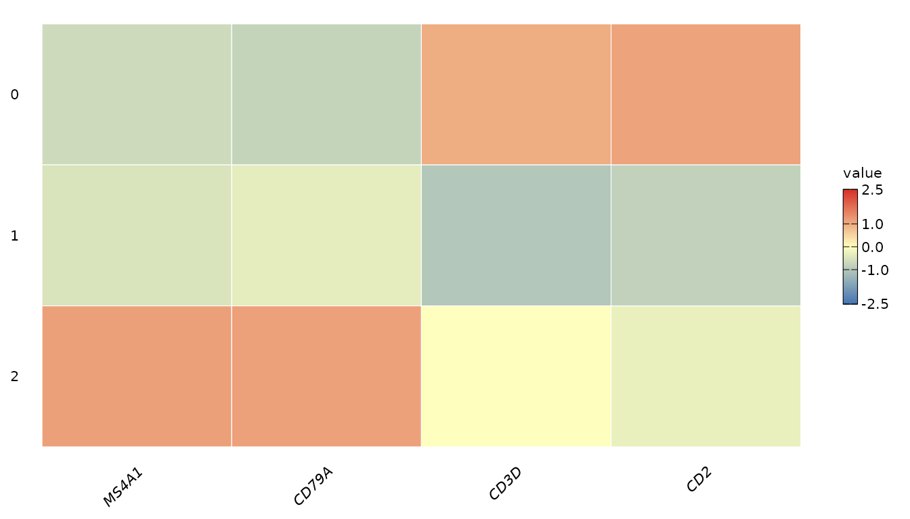
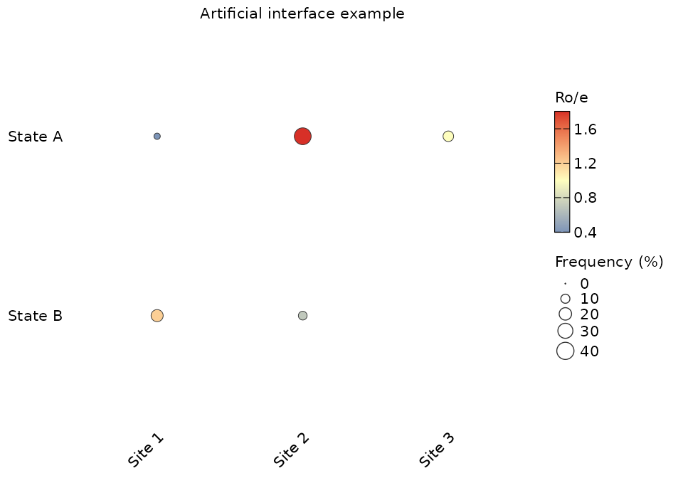
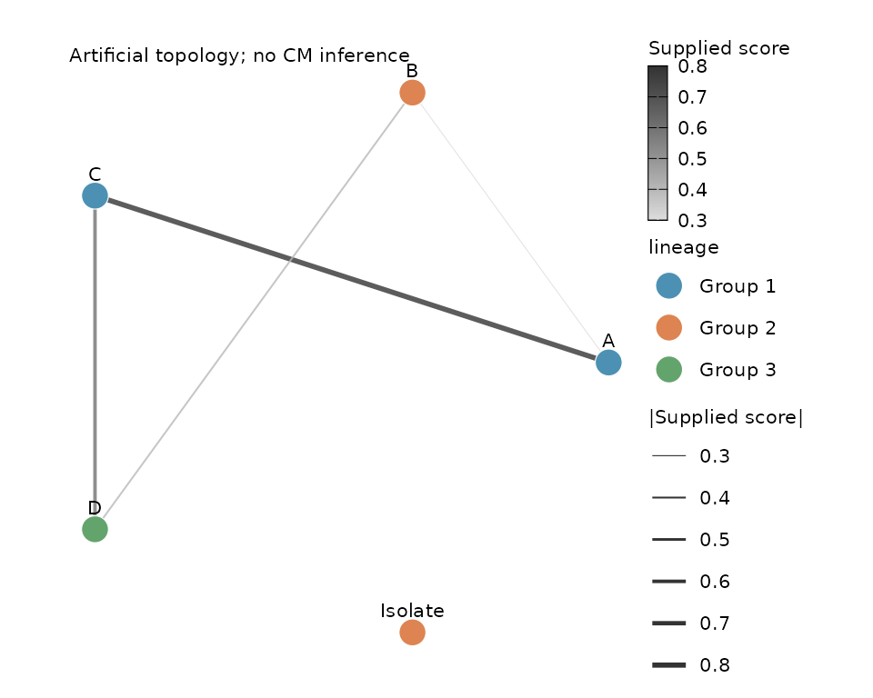

# Zhang atlas figures: visual grammar and styles

## Scope and source verification

The API provides **23 structural styles** across matrices,
distributions, effect estimates, set intersections and networks,
alongside three reusable atlas themes. Structural styles change panel
geometry: triangles, rings, annotation tracks, paired trajectories,
split densities, forests, UpSet, clone trees and weighted chord ribbons.
Typography remains 8 pt. They do not reproduce the papers’ biological
results or guarantee identical colors, coordinates, clustering or panel
layout. `style = "classic"` retains each function’s original defaults.
Explicit palettes and existing embedding (`nebula`, `glass`) and Sankey
(`A`, `B`, `C`) styles remain available.

The six papers below are the source set. Main figures were inspected for
NK, B, myeloid, fibroblast and CM. For the Science T-cell paper,
figure-caption descriptions were accessible, but the figure images were
not independently inspected; its entries are provisional layout
classifications. Supplementary and extended-data figures are **not an
exhaustive part of this inventory**. The fibroblast paper is a
cross-tissue atlas with cancer analyses. The Nature paper defines
*cellular modules*, which are different from gene modules.

``` r

papers <- read.csv(system.file("extdata", "zhang-atlas-papers.csv",
                              package = "Shennong"))
papers$Article <- sprintf("[%s (%s), %s](https://doi.org/%s)",
  papers$authors, papers$year, papers$journal, papers$doi)
knitr::kable(papers[c("paper", "title", "Article", "verification")])
```

| paper | title | Article | verification |
|:---|:---|:---|:---|
| NK | A pan-cancer single-cell panorama of human natural killer cells | [Tang et al. (2023), Cell](https://doi.org/10.1016/j.cell.2023.07.034) | figures_and_captions |
| T | Pan-cancer single-cell landscape of tumor-infiltrating T cells | [Zheng et al. (2021), Science](https://doi.org/10.1126/science.abe6474) | captions_only |
| B | Pan-cancer single-cell dissection reveals phenotypically distinct B cell subtypes | [Yang et al. (2024), Cell](https://doi.org/10.1016/j.cell.2024.06.038) | figures_and_captions |
| Myeloid | A pan-cancer single-cell transcriptional atlas of tumor infiltrating myeloid cells | [Cheng et al. (2021), Cell](https://doi.org/10.1016/j.cell.2021.01.010) | figures_and_captions |
| Fibroblast | Cross-tissue human fibroblast atlas reveals myofibroblast subtypes with distinct roles in immune modulation | [Gao et al. (2024), Cancer Cell](https://doi.org/10.1016/j.ccell.2024.08.020) | figures_and_captions |
| CM | Cross-tissue multicellular coordination and its rewiring in cancer | [Shi et al. (2025), Nature](https://doi.org/10.1038/s41586-025-09053-4) | figures_and_captions_plus_Fig2c_source_data |

## Choose a geometry before choosing a style

| Visual family | Representative panels | Input meaning and Shennong route |
|----|----|----|
| Embedding and feature maps | NK 1C–D, 3C–D; B 5D–G | [`sn_plot_dim()`](https://zerostwo.github.io/shennong/dev/reference/sn_plot_dim.md), [`sn_plot_feature()`](https://zerostwo.github.io/shennong/dev/reference/sn_plot_feature.md) preserve supplied embedding coordinates; no velocity or new embedding is inferred. |
| Marker dots | Myeloid 1E; NK 3E; B 5F; fibroblast 3A | `sn_plot_dot(style = "atlas_outline")`: color is expression, size is percent expressing. Named feature lists form marker blocks. |
| Independent bubble encodings | Fibroblast 1F; NK 6B–C; T 2A | `sn_plot_matrix(type = "bubble", size = ...)`: supply Ro/e, interaction potential or effect as color, and frequency, significance or effect as area. Legend titles must name the actual quantities. |
| Expression heatmaps | NK 3A–B; B 5I; myeloid 3B | [`sn_plot_heatmap()`](https://zerostwo.github.io/shennong/dev/reference/sn_plot_heatmap.md) keeps the chosen cell/average mode and assay/layer. Paper styles use the ggplot renderer. |
| Quantitative matrices | B 4A; CM 2c, 5f; fibroblast 5A | [`sn_plot_matrix()`](https://zerostwo.github.io/shennong/dev/reference/sn_plot_matrix.md) preserves supplied Ro/e, correlation, activity or model coefficients, including NA. Optional blocks and clustering are explicit. |
| Summary bars | T 1D–E | `sn_plot_barplot(stat = "summary", errorbar = "sd", style = "atlas")` preserves sample means and SD; select SD versus SE explicitly. |
| Sample composition | NK 2B–D; myeloid 3E; B 2A | [`sn_plot_sample_boxplot()`](https://zerostwo.github.io/shennong/dev/reference/sn_plot_sample_boxplot.md) and [`sn_plot_sample_bar()`](https://zerostwo.github.io/shennong/dev/reference/sn_plot_sample_bar.md) retain sample denominators. Samples, not cells, are biological replicates. |
| Distributions | NK 3G; B 5H; CM 4e | [`sn_plot_distribution()`](https://zerostwo.github.io/shennong/dev/reference/sn_plot_distribution.md), [`sn_plot_violin()`](https://zerostwo.github.io/shennong/dev/reference/sn_plot_violin.md): distinguish cell-level distributions from sample-aggregated values with `sample_by`. |
| Correlations and fitted trends | NK 6I; B 2B; myeloid 7E | [`sn_plot_association()`](https://zerostwo.github.io/shennong/dev/reference/sn_plot_association.md) retains the chosen correlation and fit. Style does not change test units or P values. |
| Differential expression and enrichment | NK 4; fibroblast 2E–G, 4A–B | [`sn_plot_de()`](https://zerostwo.github.io/shennong/dev/reference/sn_plot_de.md), [`sn_plot_enrichment()`](https://zerostwo.github.io/shennong/dev/reference/sn_plot_enrichment.md) style existing statistics; significance thresholds remain analysis choices. |
| Survival and effect intervals | NK 5D–E; fibroblast 4G–H; T 5B | [`sn_plot_survival()`](https://zerostwo.github.io/shennong/dev/reference/sn_plot_survival.md) renders an existing survival result. A linear coefficient forest (T 4B) must not be interpreted as a Cox HR forest. |
| Communication and module networks | NK 6; CM 2b, 5i; fibroblast 3I | [`sn_plot_communication()`](https://zerostwo.github.io/shennong/dev/reference/sn_plot_communication.md) styles its native score; [`sn_plot_network()`](https://zerostwo.github.io/shennong/dev/reference/sn_plot_network.md) renders supplied edges and nodes. The latter also accepts fixed coordinates for matched network comparisons. |
| Spatial coordinates and features | Fibroblast 5D–F; CM 3, 4g | `sn_plot_spatial*()` uses existing coordinates/sections. Histology and segmented-cell outlines require their original image assets. |
| Set, tree and circular layouts | B 2C/3D/4L; CM 4c; fibroblast 6B | `sn_plot_overlap(style="upset")`, `sn_plot_network(style="clone_tree"/"chord")`, `sn_plot_matrix(style="split_triangle"/"circular")`. Supply sets, topology and scores explicitly. |

Circular phylogenetic dendrograms, Venn diagrams, FACS gates, ATAC
tracks, microscopy and hand-drawn cluster outlines remain outside these
structural styles. Clone trees use supplied rooted topology; they do not
reconstruct BCR lineages. The `raincloud` layout is an adaptation of
violin/box/sample-dot conventions, not a claim of an identical source
panel.

## Structural styles and panel references

``` r

layouts <- sn_list_plot_styles()
layouts <- layouts[layouts$kind == "structure" & !duplicated(layouts$style), ]
knitr::kable(layouts[c("function_name", "style", "reference", "data_requirements")])
```

| function_name | style | reference | data_requirements |
|:---|:---|:---|:---|
| sn_plot_matrix | upper_triangle | B 2024 Fig. 4L (single half adaptation) | square matrix; identical ordered axis IDs |
| sn_plot_matrix | lower_triangle | B 2024 Fig. 4L (single half adaptation) | square matrix; identical ordered axis IDs |
| sn_plot_matrix | split_triangle | B 2024 Fig. 4L | x and compare; same axes and statistic |
| sn_plot_matrix | circular | CM Nature 2025 Fig. 4C | named numeric matrix |
| sn_plot_matrix | annotated | CM Nature 2025 Fig. 2C and 4I | row_annotation and/or column_annotation |
| sn_plot_matrix | dendrogram | NK 2023 Fig. 3A-B; B 2024 Fig. 4A | finite matrix; Euclidean complete-linkage clustering |
| sn_plot_matrix | grouped_bubble | Fibroblast 2024 Fig. 1F and 3A/D | independent color matrix x and area matrix size; named splits |
| sn_plot_matrix | heatmap_bar | CM Nature 2025 Fig. 5F | named row_summary; statistic explicitly supplied |
| sn_plot_matrix | heatmap_density | Myeloid 2021 Fig. 4B; CM Nature 2025 Fig. 4D | named column_summary; no automatic density inference |
| sn_plot_distribution | violin_box | NK 2023 Fig. 3G; T 2021 Fig. 2F | numeric observations and groups |
| sn_plot_distribution | raincloud | adaptation of atlas violin/box/sample-dot grammar | at least two observations per feature and group |
| sn_plot_distribution | paired_box | Myeloid 2021 Fig. 3E and 6C | pair_by; one complete subject/group/feature observation |
| sn_plot_distribution | paired_slope | Fibroblast 2024 Fig. 6F; CM Nature 2025 Fig. 3G | pair_by; optional sample_by aggregation |
| sn_plot_distribution | split_violin | CM Nature 2025 Fig. 4E | exactly two groups; each feature is a row |
| sn_plot_distribution | stacked_violin | Myeloid 2021 Fig. 5C; Fibroblast 2024 Fig. 1D | multiple features and groups |
| sn_plot_effect | forest | B 2024 Fig. 5A-C; T 2021 Fig. 4B and 5B | label estimate lower upper; identity or positive ratio scale |
| sn_plot_effect | diverging_bar | B 2024 Fig. 3A; CM Nature 2025 Fig. 5J | label and estimate; identity scale |
| sn_plot_effect | lollipop | NK 2023 Fig. 2A | label and estimate; identity or ratio scale |
| sn_plot_overlap | upset | B 2024 Fig. 2C | named sets of unique sample IDs |
| sn_plot_network | bipartite | Fibroblast 2024 Fig. 3I | group_by defines exactly two partitions; cross-partition edges |
| sn_plot_network | clone_tree | B 2024 Fig. 3D | supplied rooted topology; optional branch_length |
| sn_plot_network | chord | Fibroblast 2024 Fig. 6B | non-negative weights; no directed arrows |
| sn_plot_network | rewiring | CM Nature 2025 Fig. 5I | edges and compare_edges; common node table |

Use `sn_list_plot_styles("sn_plot_distribution")` to discover styles
accepted by one function. These styles are function-specific:
`style="upset"` belongs to
[`sn_plot_overlap()`](https://zerostwo.github.io/shennong/dev/reference/sn_plot_overlap.md),
not to an embedding renderer. The original
`sn_plot_heatmap(mode="average")` accepts matrix structures and forwards
annotation/summary arguments through `...`;
[`sn_plot_violin()`](https://zerostwo.github.io/shennong/dev/reference/sn_plot_violin.md)
also accepts `violin_box`, `raincloud`, `split_violin`, and
`stacked_violin`. Use
[`sn_plot_distribution()`](https://zerostwo.github.io/shennong/dev/reference/sn_plot_distribution.md)
for tables, explicit assay/layer choices and sample aggregation.
Existing defaults remain unchanged.

The examples below are synthetic layout demonstrations. They are not the
paper’s cancer data. The separate Nature workbook recipe uses original
values.

``` r

set.seed(102)
m <- matrix(rnorm(24), 4, dimnames = list(paste0("State ", 1:4), paste0("Site ", 1:6)))
correlation <- cor(t(m))
p1 <- sn_plot_matrix(correlation, style = "split_triangle",
  compare = correlation * 0.6, midpoint = 0, limits = c(-1, 1))
p2 <- sn_plot_matrix(m, style = "circular", midpoint = 0)
patchwork::wrap_plots(p1, p2)
```



`split_triangle` keeps `x` above and `compare` below the omitted
diagonal. Both axes must have identical ordered IDs. Independent
clustering is rejected. `dendrogram` clusters both axes using Euclidean
distance and complete linkage; its new dendrogram is not claimed to
match an unpublished paper tree.

``` r

annotation <- data.frame(system = rep(c("A", "B"), each = 3), row.names = colnames(m))
sn_plot_matrix(m, style = "annotated", column_annotation = annotation, midpoint = 0)
```



For `heatmap_bar`, supply `row_summary = setNames(values, rownames(m))`;
for `heatmap_density`, supply
`column_summary = setNames(values, colnames(m))`. These tracks display
your supplied statistic. `grouped_bubble` requires an independent
non-negative `size` matrix plus a named `row_split` or `column_split`;
area zero remains invisible.

``` r

samples <- data.frame(subject = rep(paste0("P", 1:12), 2),
  condition = rep(c("Pre", "Post"), each = 12),
  score = c(rnorm(12), rnorm(12, 1)))
a <- sn_plot_distribution(samples, "score", "condition", style = "raincloud")
b <- sn_plot_distribution(samples, "score", "condition", style = "paired_box", pair_by = "subject")
patchwork::wrap_plots(a, b)
```



Paired plots require one observation per subject/group/feature and
complete pairs across groups. For cell-level tables, aggregate using a
unique specimen `sample_by` column and identify matched patients with
`pair_by`. The plot does not pair by row order, impute missing subjects
or calculate a P value. `split_violin` draws two horizontal half
densities per feature, each normalized to its own maximum width, with
median marks; width is not relative cell count.

``` r

effects <- data.frame(label = c("NK", "B", "Myeloid"),
  estimate = c(-0.5, 0.2, 0.8), lower = c(-0.8, -0.1, 0.4), upper = c(-0.2, 0.5, 1.2))
a <- sn_plot_effect(effects, style = "forest", value_label = "Coefficient (95% CI)")
b <- sn_plot_overlap(list(B = c("S1", "S2", "S3"), T = c("S2", "S4"), Myeloid = c("S2", "S3")))
patchwork::wrap_plots(a, b)
```



For HR/OR forests use `scale="ratio"` and strictly positive supplied
intervals; the reference becomes one and the axis logarithmic.
`identity` uses zero. UpSet bars count **exclusive** intersections;
every ID belongs to exactly one bar. Empty intersections are omitted;
duplicate IDs within a set are rejected.

``` r

links <- data.frame(source = c("A", "A", "B"), target = c("B", "C", "D"), weight = c(1, 3, 2))
a <- sn_plot_network(links, style = "clone_tree")
b <- sn_plot_network(links, style = "chord", weight_label = "Supplied interaction weight")
patchwork::wrap_plots(a, b)
```



`clone_tree` requires a connected rooted tree; its default branch
distance is unit edge depth, or the supplied `branch_length` column.
`chord` requires non-negative weights; ribbon endpoints and sector
widths encode incident weight, not node counts. `bipartite` uses two
explicit node groups. `rewiring` accepts `compare_edges`; both panels
share node coordinates and edge scales, retaining absent edges as
absent. None infer biological interactions.

The repository’s `scripts/smoke/atlas-figure-layouts.R` exports all 23
styles to PDF/PNG and source-data bundles, with an independent 408-value
Nature readback.

## Compare the reusable styles

``` r

sn_list_plot_styles()
#> # A tibble: 40 × 7
#>    style          description     reference changes_analysis kind  function_name
#>    <chr>          <chr>           <chr>     <lgl>            <chr> <chr>        
#>  1 classic        Original funct… NA        FALSE            theme ggplot rende…
#>  2 atlas          Compact atlas … NK Cell … FALSE            theme ggplot rende…
#>  3 atlas_outline  Outlined bubbl… Myeloid … FALSE            theme ggplot rende…
#>  4 atlas_module   Module-oriente… Cellular… FALSE            theme ggplot rende…
#>  5 upper_triangle upper triangul… B 2024 F… FALSE            stru… sn_plot_matr…
#>  6 lower_triangle lower triangul… B 2024 F… FALSE            stru… sn_plot_matr…
#>  7 split_triangle two matrices i… B 2024 F… FALSE            stru… sn_plot_matr…
#>  8 circular       annular heatma… CM Natur… FALSE            stru… sn_plot_matr…
#>  9 annotated      heatmap with c… CM Natur… FALSE            stru… sn_plot_matr…
#> 10 dendrogram     heatmap with r… NK 2023 … FALSE            stru… sn_plot_matr…
#> # ℹ 30 more rows
#> # ℹ 1 more variable: data_requirements <chr>
```

`atlas` uses solid marks and clean atlas panels; `atlas_outline` uses
thin outlined bubbles and open boxplots; `atlas_module` uses sequential
purple activity maps and grey network edges. These are shared presets,
not claims that every panel in one paper has the same palette. Signed
matrices can use `midpoint = 0`; Ro/e matrices can use `midpoint = 1`.
Supply `limits` explicitly when comparing panels on a common scale. No
automatic log transform or significance conversion occurs.

The following is the real 80-cell `pbmc_small` teaching dataset
distributed with SeuratObject, with its original identities and t-SNE.
It is not data from the six cancer papers and is not a validation of
their cell labels.

``` r

pbmc <- SeuratObject::pbmc_small
sn_plot_dim(pbmc, reduction = "tsne", style = "atlas", raster = FALSE)
```



``` r

markers <- list(B = c("MS4A1", "CD79A"), T = c("CD3D", "CD2"))
plots <- lapply(c("classic", "atlas", "atlas_outline"), function(style) {
  sn_plot_dot(pbmc, features = markers, style = style) + ggplot2::ggtitle(style)
})
patchwork::wrap_plots(plots, nrow = 1)
```



``` r

sn_plot_heatmap(pbmc, unlist(markers), layer = "data", mode = "average",
                style = "atlas_outline")
```



Atlas dot styles currently reject `split_by`: Seurat’s split-dot color
encoding differs from a shared quantitative scale. Use named feature
blocks or separate panels with explicitly matched limits. Heatmap atlas
styles currently require `backend = "ggplot2"`; the other heatmap
renderers retain their native controls.

## Reproduce Nature Fig. 2c from its source numbers

The publisher provides a [source workbook for Fig.
2](https://static-content.springer.com/esm/art%3A10.1038%2Fs41586-025-09053-4/MediaObjects/41586_2025_9053_MOESM6_ESM.xlsx).
Sheet `Fig. 2c`, after its first explanatory row, contains 12 CMs and 34
tissue columns. Some very small numbers are stored as
scientific-notation text;
[`as.numeric()`](https://rdrr.io/r/base/numeric.html) parses them
without adding pseudocounts. The recipe below preserves all 408 values
and their source order. Color is capped at 3 for display while source
values remain intact. The paper’s dendrogram and exact color lookup are
not reconstructed; this is a new rendering of the supplied numerical
matrix, not a modified copy of the original figure. The original figures
are not bundled with Shennong.

``` r

d <- readxl::read_excel("41586_2025_9053_MOESM6_ESM.xlsx",
                         sheet = "Fig. 2c", skip = 1)
roe <- vapply(d[-1], as.numeric, numeric(nrow(d)))
rownames(roe) <- d[[1]]
p <- sn_plot_matrix(roe, style = "atlas_module",
                     palette = c("#FFFFFF", "#FCAE91", "#CB181D"), limits = c(0, 3),
                     value_label = "Ro/e", title = "CM tissue prevalence")
stopifnot(identical(attr(p, "shennong_figure_data")$matrix, roe))
sn_export_figure_bundle(p, "cm-fig2c", width = 240, height = 115)
```

Read-only numeric source matrices are retained in the plot’s
`shennong_figure_data` attribute. Figure bundles write them as CSV with
an explicit `.shennong_row` column (or a collision-free variant),
together with the PDF/PNG, figure specification and checksummed
manifest. Network bundles include separate original edge/node tables and
rendered coordinates.

The repository script `scripts/smoke/atlas-figure-styles.R` downloads
this workbook only when invoked with `--download`, records its URL and
SHA-256, exports the figure, reads the CSV back and verifies every
value. It also produces a PDF/PNG comparison gallery. Running it without
`--download` uses the existing local workbook and fails clearly if it is
missing.

## Supplied matrix and network examples

The next examples use explicitly artificial numbers to demonstrate the
interface; they are not reported biological findings.

``` r

score <- matrix(c(0.4, 1.2, 1.8, 0.7, 1, NA), 2,
                dimnames = list(c("State A", "State B"), c("Site 1", "Site 2", "Site 3")))
frequency <- score; frequency[] <- c(5, 20, 40, 10, 15, 0)
sn_plot_matrix(score, type = "bubble", size = frequency,
                midpoint = 1, style = "atlas_outline",
                value_label = "Ro/e", size_label = "Frequency (%)",
                title = "Artificial interface example")
```



``` r

edges <- data.frame(source = c("A", "A", "B", "C"),
                    target = c("B", "C", "D", "D"),
                    weight = c(0.3, 0.8, 0.4, 0.6))
nodes <- data.frame(node = c("A", "B", "C", "D", "Isolate"),
                    lineage = c("Group 1", "Group 2", "Group 1", "Group 3", "Group 2"))
sn_plot_network(edges, nodes, group_by = "lineage", style = "atlas_module",
                 weight_label = "Supplied score",
                 title = "Artificial topology; no CM inference")
```



## Main-figure inventory

This index classifies 38 main figures. Routes identify useful renderers;
they do not promise every listed subpanel is reproduced by one function.
Existing trajectory/velocity views retain their own presentation
controls. The three CSV catalogs (papers, figures and layouts) are
installed under `system.file("extdata", package = "Shennong")`, so the
classifications and verification status remain inspectable.

``` r

inventory <- read.csv(system.file("extdata", "zhang-atlas-figures.csv",
                                package = "Shennong"))
for (paper in papers$paper) {
  cat("\n\n### ", paper, "\n\n", sep = "")
  rows <- inventory[inventory$paper == paper, -1]
  print(knitr::kable(rows))
}
```

### NK

| figure | visual_families | shennong_route | boundary |
|---:|:---|:---|:---|
| 1 | UMAP; violin; expression heatmap; score bars | sn_plot_dim; sn_plot_distribution; sn_plot_heatmap | Expression and cluster identities supplied |
| 2 | Relative-ratio lollipop; sample boxes; paired comparisons; receptor heatmap | sn_plot_effect(style=lollipop); sn_plot_distribution(style=paired_box); sn_plot_matrix | Supply ratios and explicit subject IDs; no model fitting |
| 3 | Cell heatmap; feature maps; marker dots; FACS; violin; mean-expression matrix | sn_plot_heatmap; sn_plot_feature; sn_plot_dot; sn_plot_matrix | FACS gates require original measurements and a specialist renderer |
| 4 | Velocity; volcano; density; gene trends; sample comparisons; microscopy | sn_plot_de; sn_plot_distribution; existing trajectory and velocity views | Microscopy is an external image asset; velocity is not inferred by style |
| 5 | Signature heatmap; sample boxes; Cox forest; Kaplan-Meier; response boxes | sn_plot_matrix; sn_plot_sample_boxplot; sn_plot_survival | Survival plots require a fitted stored survival result |
| 6 | Interaction-count matrix; LR bubble; marker dots; density; correlation; microscopy | sn_plot_matrix; sn_plot_dot; sn_plot_association; sn_plot_distribution | LR bubble size is significance; marker-dot size is percentage |
| 7 | Biological summary schematic | External illustration | No quantitative renderer |

### T

|  | figure | visual_families | shennong_route | boundary |
|:---|---:|:---|:---|:---|
| 8 | 1 | UMAP; frequency summary bars; odds-ratio heatmap; expansion-proliferation scatter | sn_plot_dim; sn_plot_matrix; sn_plot_association | Captions only; frequency bars use mean and SD; odds ratio is not Ro/e |
| 9 | 2 | Effect-size dots; velocity; transition heatmap; feature maps; violin-box; sample boxes; TF bars; ranked scatter | sn_plot_matrix; sn_plot_feature; sn_plot_distribution; existing velocity views | Both dot size and color can encode effect; thresholded transition values must be supplied |
| 10 | 3 | Diffusion and velocity; pseudotime heatmap with density; transition matrix; regulatory network | sn_plot_matrix(style=heatmap_density); sn_plot_network; existing trajectory views | Caption-only classification; pseudotime/density supplied |
| 11 | 4 | Frequency boxes; linear-coefficient forest; Venn | sn_plot_effect(style=forest); sn_plot_sample_boxplot; external Venn renderer | Linear coefficient uses identity/zero; Cox HR uses ratio/one |
| 12 | 5 | Clustered frequency heatmap with side panels; Cox forest; response boxes | sn_plot_matrix; sn_plot_survival; sn_plot_distribution | Joint clustering and multi-panel alignment require explicit assembly |

### B

|  | figure | visual_families | shennong_route | boundary |
|:---|---:|:---|:---|:---|
| 13 | 1 | Hierarchical embeddings; signature heatmap; isotype stacks; SHM dots and boxes; spatial-distance area | sn_plot_dim; sn_plot_matrix; sn_plot_composition; sn_plot_distribution | Exact inset hierarchy and distance-area composition require assembly |
| 14 | 2 | Sample boxes; correlation; UpSet; dendrogram with composition | sn_plot_overlap(style=upset); sn_plot_sample_boxplot; sn_plot_association; sn_plot_composition | UpSet implemented; dendrogram-plus-composition composite still requires assembly |
| 15 | 3 | Diverging pathway bars; correlation; sample boxes; clone tree; heatmap | sn_plot_effect(style=diverging_bar); sn_plot_network(style=clone_tree); sn_plot_association; sn_plot_matrix | Clone-tree topology and branch lengths supplied; no BCR inference |
| 16 | 4 | Annotated Ro/e matrix; clone stacks; boxes; correlation; pies; switching triangle; histology | sn_plot_matrix(style=annotated/split_triangle); sn_plot_composition; sn_plot_distribution; sn_plot_association | x upper and compare lower with identical axes; histology external |
| 17 | 5 | Forest plots; UMAP; grouped marker dots; feature maps; violin; cell heatmap | sn_plot_effect(style=forest); sn_plot_survival; sn_plot_dim; sn_plot_dot; sn_plot_feature; sn_plot_violin; sn_plot_heatmap | Generic supplied intervals supported; statistic and scale must be explicit |
| 18 | 6 | Box; ATAC tracks; heatmap; enrichment; ranked regulons; bars; FACS; velocity; trends | sn_plot_distribution; sn_plot_matrix; sn_plot_enrichment; existing velocity and trend views | ATAC tracks and FACS need modality-specific inputs/renderers |
| 19 | 7 | Microscopy; distance violin; heatmap; LR bubble; expression dot; sample comparisons | sn_plot_distribution; sn_plot_matrix; sn_plot_dot; sn_plot_sample_boxplot | Spatial distances and interaction scores must be computed before plotting |

### Myeloid

|  | figure | visual_families | shennong_route | boundary |
|:---|---:|:---|:---|:---|
| 20 | 1 | Cohort bars; UMAP; feature maps; outlined grouped marker dots; presence matrix | sn_plot_composition; sn_plot_dim; sn_plot_feature; sn_plot_dot; sn_plot_matrix | Presence matrix is not abundance |
| 21 | 2 | Circular dendrogram; sample boxes; volcano; microscopy; log-ratio bars; KM; LR matrix; correlation | sn_plot_distribution; sn_plot_de; sn_plot_survival; sn_plot_matrix; sn_plot_association | Circular dendrogram needs a specialist renderer and tree |
| 22 | 3 | Dendrogram; cell heatmap; microscopy; boxes; paired comparisons; volcano; signed heatmap | sn_plot_heatmap; sn_plot_distribution; sn_plot_de; sn_plot_matrix | Pair identifiers and signed statistic definitions must be retained |
| 23 | 4 | Trajectory; pseudotime heatmap and density; boxes; volcano; TF and ligand-target matrices | sn_plot_distribution; sn_plot_de; sn_plot_matrix; existing trajectory views | Pseudotime and regulatory scores are upstream results |
| 24 | 5 | Boxes; UMAP with outline; stacked violin; Ro/e; TF matrix; pie | sn_plot_distribution; sn_plot_dim; sn_plot_violin; sn_plot_matrix; sn_plot_composition | Hand-drawn cluster contours are not generated by style |
| 25 | 6 | Circular dendrogram; Ro/e; paired boxes; microscopy; functional matrix; KM | sn_plot_matrix; sn_plot_distribution; sn_plot_survival | Original sample pairing required for paired analysis |
| 26 | 7 | Coefficient heatmaps; sample boxes; correlation with fitted trend | sn_plot_matrix; sn_plot_distribution; sn_plot_association | Preserve model coefficients and sample-level units |

### Fibroblast

|  | figure | visual_families | shennong_route | boundary |
|:---|---:|:---|:---|:---|
| 27 | 1 | UMAP outline; stacked violin; cell heatmap; frequency-Ro/e bubbles; phenotype matrix | sn_plot_dim; sn_plot_violin; sn_plot_heatmap; sn_plot_matrix | Bubble color is Ro/e and area is frequency; no automatic cluster hulls |
| 28 | 2 | Sample boxes; composition stacks; average heatmap; volcano; pathway bars; schematic | sn_plot_distribution; sn_plot_composition; sn_plot_heatmap; sn_plot_de; sn_plot_enrichment | Schematic is a separate illustration |
| 29 | 3 | Grouped dots; velocity; microscopy; pathway-effect bubbles; forest; horizontal boxes; TF matrix; bipartite GRN; LR heatmap | sn_plot_dot; sn_plot_matrix(style=grouped_bubble); sn_plot_effect; sn_plot_distribution; sn_plot_network(style=bipartite) | Two node partitions required; weights and forest intervals supplied |
| 30 | 4 | Volcano; enrichment; boxes; microscopy; clustered composition and matrix; KM; forest | sn_plot_de; sn_plot_enrichment; sn_plot_distribution; sn_plot_matrix; sn_plot_survival | Shared clustering/order must be supplied for composite panels |
| 31 | 5 | Correlation matrix with module blocks; dots; spatial features and density | sn_plot_matrix; sn_plot_dot; sn_plot_spatial_feature | Module boundaries and spatial coordinates are input data |
| 32 | 6 | Microscopy; LR chord; spatial maps; boxes; paired slopes | sn_plot_network(style=chord); sn_plot_spatial; sn_plot_distribution(style=paired_slope) | Weighted ribbon geometry and subject pairing implemented; microscopy external |
| 33 | 7 | Biological summary schematic | External illustration | No quantitative renderer |

### CM

|  | figure | visual_families | shennong_route | boundary |
|:---|---:|:---|:---|:---|
| 34 | 1 | UMAP; horizontal stacks; circular dendrogram; tissue Ro/e; spatial grids | sn_plot_dim; sn_plot_composition; sn_plot_matrix; sn_plot_spatial | Tree and spatial composition panels require explicit upstream inputs |
| 35 | 2 | Circular module networks; clustered tissue Ro/e; descriptive table | sn_plot_network; sn_plot_matrix | Fig 2c source matrix verified: 12 modules by 34 tissues; no CoVarNet inference |
| 36 | 3 | Spatial grids; Xenium; boxes; paired slopes; heatmap; dots; spatial gene maps | sn_plot_spatial; sn_plot_distribution; sn_plot_matrix; sn_plot_dot; sn_plot_spatial_feature | Histology and segmented Xenium cells are not recreated by point maps |
| 37 | 4 | Boxes; activity matrices; circular regulon heatmap; split violin; spatial maps; PHATE; trend | sn_plot_matrix(style=circular/annotated); sn_plot_distribution(style=split_violin); sn_plot_spatial; sn_plot_dim; sn_plot_association | Ring and split density layouts implemented; PHATE/regulon values supplied |
| 38 | 5 | Dots; activity matrices; boxes; co-occurrence heatmap; paired network rewiring; signed bars | sn_plot_matrix(style=heatmap_bar); sn_plot_network(style=rewiring); sn_plot_effect(style=diverging_bar); sn_plot_dot; sn_plot_distribution | Both networks share node coordinates and scales; row summaries supplied |
